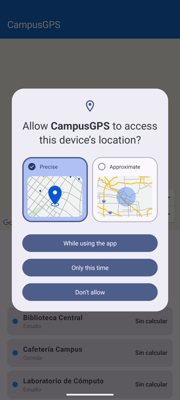
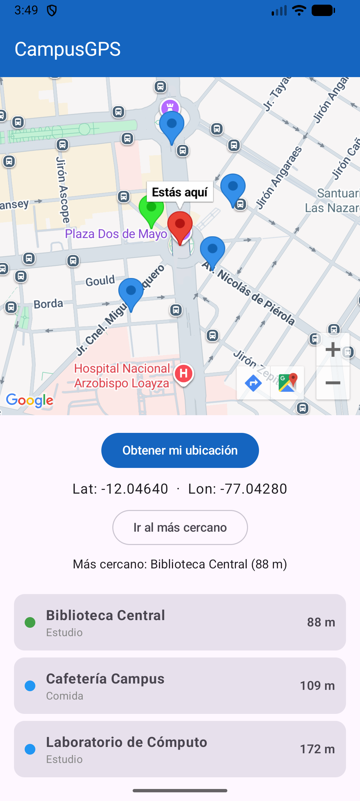
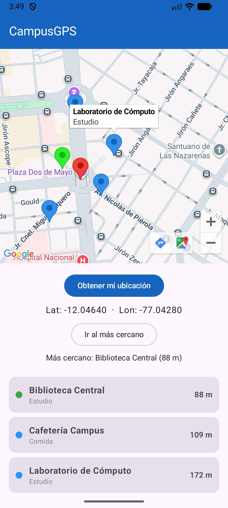
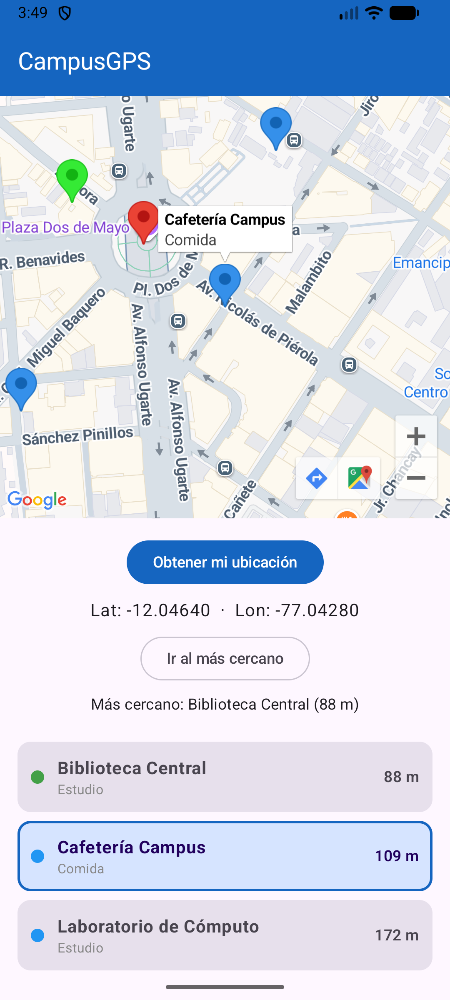
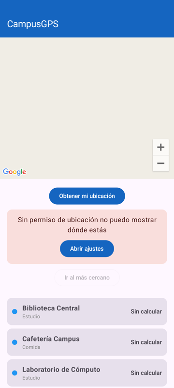

# CampusGPS

App Android que obtiene la ubicación del celular, la muestra en un mapa y dice qué lugar del campus está más cerca. Muestra cinco puntos ficticios (biblioteca, cafetería, laboratorio, auditorio y estacionamiento) con su distancia en metros, ordenados del más cercano al más lejano.

- **Tecnología:** Kotlin, Jetpack Compose, Material 3 (sin XML), Google Play Services Location (`FusedLocationProviderClient`) y Maps Compose.
- **Arquitectura:** MVVM + Repository (interfaces).
- **Curso:** Programación en Móviles, Laboratorio 13 (Localización geográfica).

## Cómo ejecutarlo

1. Abre el proyecto en Android Studio y sincroniza Gradle.
2. Crea una clave de **Maps SDK for Android** en Google Cloud y restríngela al paquete `com.tecsup.campusgps` y a tu SHA-1 (`./gradlew signingReport`).
3. Agrega la clave en `local.properties`, que no se sube a Git:
   ```properties
   MAPS_API_KEY=tu_clave_aqui
   ```
4. Usa un emulador **con Google Play** y ubícalo en el punto base: *Extended controls → Location → `-12.0464`, `-77.0428` → Set location*.
5. Ejecuta la app y pulsa **Obtener mi ubicación**.

## Estructura de paquetes

```
com.tecsup.campusgps/
├── MainActivity.kt
├── model/
│   └── Modelos.kt                    Posicion, Lugar, LugarConDistancia, UbicacionUi, TipoError
├── data/
│   ├── UbicacionRepository.kt        interface (+ UbicacionNoDisponibleException)
│   ├── UbicacionRepositoryGoogle.kt  implementación con Fused y GoogleApiAvailability
│   ├── LugaresRepository.kt          interface
│   └── LugaresRepositoryLocal.kt     los 5 lugares ficticios
├── util/
│   ├── Distancia.kt                  distanciaMetros() con Location.distanceBetween
│   └── Formato.kt                    formatearDistancia(): "350 m" / "1.5 km"
├── viewmodel/
│   ├── MapaViewModel.kt              estado, lugares, seleccionado, masCercano
│   └── CampusViewModelFactory.kt
└── ui/
    ├── PantallaMapa.kt               pantalla principal y permisos en tiempo de ejecución
    ├── MapaUbicacion.kt              GoogleMap, cámara y marcadores
    ├── ListaLugares.kt               LazyColumn de tarjetas
    ├── MensajeError.kt               mensaje + acción según el TipoError
    └── theme/
```

## Arquitectura MVVM + Repository

```
View (PantallaMapa, MapaUbicacion, ListaLugares, MensajeError)
   |  eventos: botón, tocar tarjeta      ^  collectAsStateWithLifecycle()
   v                                     |
ViewModel (MapaViewModel)  --- StateFlow: estado, lugares, seleccionado, masCercano --->
   |  llama solo a interfaces (sin Context)
   v
UbicacionRepository  ---> UbicacionRepositoryGoogle (FusedLocationProviderClient)
LugaresRepository    ---> LugaresRepositoryLocal (los 5 lugares fijos)
util/  ---> distanciaMetros(), formatearDistancia()  (funciones puras)
```

| Capa | Responsabilidad |
|---|---|
| View (`ui/`) | Solo dibuja según el estado y envía eventos al ViewModel. No calcula distancias. |
| ViewModel | Coordina: pide la posición, calcula y ordena las distancias, decide el tipo de error. No recibe `Context`. |
| Repository | Habla con Google Play Services (Fused, `GoogleApiAvailability`). |
| `util/` | Funciones puras, sin estado. |

## Capturas

| Permiso | Mapa con mi ubicación | Marcadores |
|---|---|---|
|  |  |  |

| Lista ordenada | Error |
|---|---|
|  |  |

## Pruebas de aceptación

| Prueba | Resultado esperado | OK |
|---|---|---|
| Abrir la app por primera vez y pulsar el botón | Aparece el cuadro de permiso | ✅ |
| Aceptar el permiso | Se ven latitud, longitud y el marcador *Estás aquí* | ✅ |
| Negar el permiso | Mensaje de error con *Abrir ajustes*; la app no se cierra | ✅ |
| Ubicación en el punto base | Los 5 marcadores azules aparecen cerca de tu posición | ✅ |
| Tocar un marcador | Se ven el nombre y la categoría del lugar | ✅ |
| Lista de lugares | Ordenada de menor a mayor distancia, con m o km | ✅ |
| Tocar una tarjeta de la lista | La cámara viaja a ese lugar y la tarjeta queda resaltada | ✅ |
| Ir al más cercano | La cámara va al lugar verde; el botón está deshabilitado antes de buscar | ✅ |
| Cambiar la ubicación del emulador y buscar otra vez | Se actualizan las distancias, el orden y el lugar verde | ✅ |
| Ubicación apagada | Mensaje de GPS con *Reintentar* | ✅ |
| Rotar la pantalla | No se pierden la ubicación ni la lista (el estado vive en el ViewModel) | ✅ |
| Revisar el repositorio | `git grep "AIza"` no encuentra nada y `local.properties` no está subido | ✅ |

## Para pensar

**1. ¿Por qué `FusedLocationProviderClient` está dentro del Repository y no en el ViewModel?**
Porque es un detalle de *cómo* se obtiene la ubicación y necesita un `Context`. El ViewModel solo conoce la interface `UbicacionRepository` y recibe un `Result<Posicion>`. Así el ViewModel no depende de Google Play Services ni guarda un `Context`, que podría causar fugas de memoria al rotar. Además se puede probar con un repositorio falso, y si mañana cambiamos de proveedor de ubicación solo cambia la implementación.

**2. ¿Qué diferencia hay entre el permiso de ubicación y la clave de API de Maps? ¿Qué pasa si falta cada uno?**
El **permiso** lo concede el **usuario** en tiempo de ejecución y autoriza a la app a leer la ubicación del dispositivo. Si falta, `getCurrentLocation` lanza `SecurityException` y la app muestra "Sin permiso…" con *Abrir ajustes*. El mapa sigue funcionando, pero sin el marcador *Estás aquí*. La **clave de API** identifica a la **app** ante Google para usar Maps SDK. Si falta o está mal restringida, el mapa sale gris o en blanco ("Authorization failure" en Logcat), pero la ubicación, la lista y las distancias siguen funcionando, porque son servicios distintos.

**3. ¿Por qué la clave va en `local.properties` y no en el código? ¿Qué harías si se subiera a GitHub por error?**
`local.properties` está en `.gitignore`, así que la clave nunca llega al repositorio. Gradle la lee y la inyecta en el Manifest con `manifestPlaceholders["MAPS_API_KEY"]`. Si estuviera en el código, cualquiera que vea el repo podría usarla y generar consumo a mi cuenta. Si se subiera por error: **la borro en Google Cloud y creo una nueva**, porque la anterior ya no es segura aunque borre el commit (queda en el historial y en copias). Después reviso que `.gitignore` incluya `local.properties`.

**4. ¿Dónde calculas la distancia y por qué no en el Composable?**
En `util/Distancia.kt` (`distanciaMetros`, una función pura con `Location.distanceBetween`), llamada desde `MapaViewModel.actualizarDistancias()` solo cuando llega la ubicación con éxito. Un Composable se recompone muchas veces (scroll, animaciones, rotación). Calcular ahí repetiría el trabajo, mezclaría lógica con dibujo y rompería MVVM. La pantalla solo recibe `List<LugarConDistancia>` ya ordenada y la dibuja.

**5. ¿Qué pasa con tu app si el usuario niega el permiso dos veces? ¿Cómo lo manejas?**
Desde Android 11, si el usuario niega dos veces, el sistema deja de mostrar el cuadro: `launch()` devuelve "denegado" al instante. La app no se cierra. `vm.permisoDenegado()` pone el estado `Error(tipo = SIN_PERMISO)` y `MensajeError` muestra *Abrir ajustes*, que lanza `Settings.ACTION_APPLICATION_DETAILS_SETTINGS` con `Uri.fromParts("package", packageName, null)`. Ahí el usuario puede activar la ubicación a mano. Al volver y pulsar el botón, `checkSelfPermission` ya da concedido y se llama directo a `vm.buscar()`.

## Notas de actualización

La guía usa versiones de hace algunos años. Este proyecto usa AGP 9.4.1, Kotlin 2.4.20, `play-services-location` 21.4.0 y `maps-compose` 9.0.1. Con AGP 9, Kotlin viene integrado y no hace falta el plugin `kotlin-android`. También se agregó un tiempo límite de 15 s a `getCurrentLocation`, para que la app no se quede en "Buscando" si el emulador no entrega ubicación.
